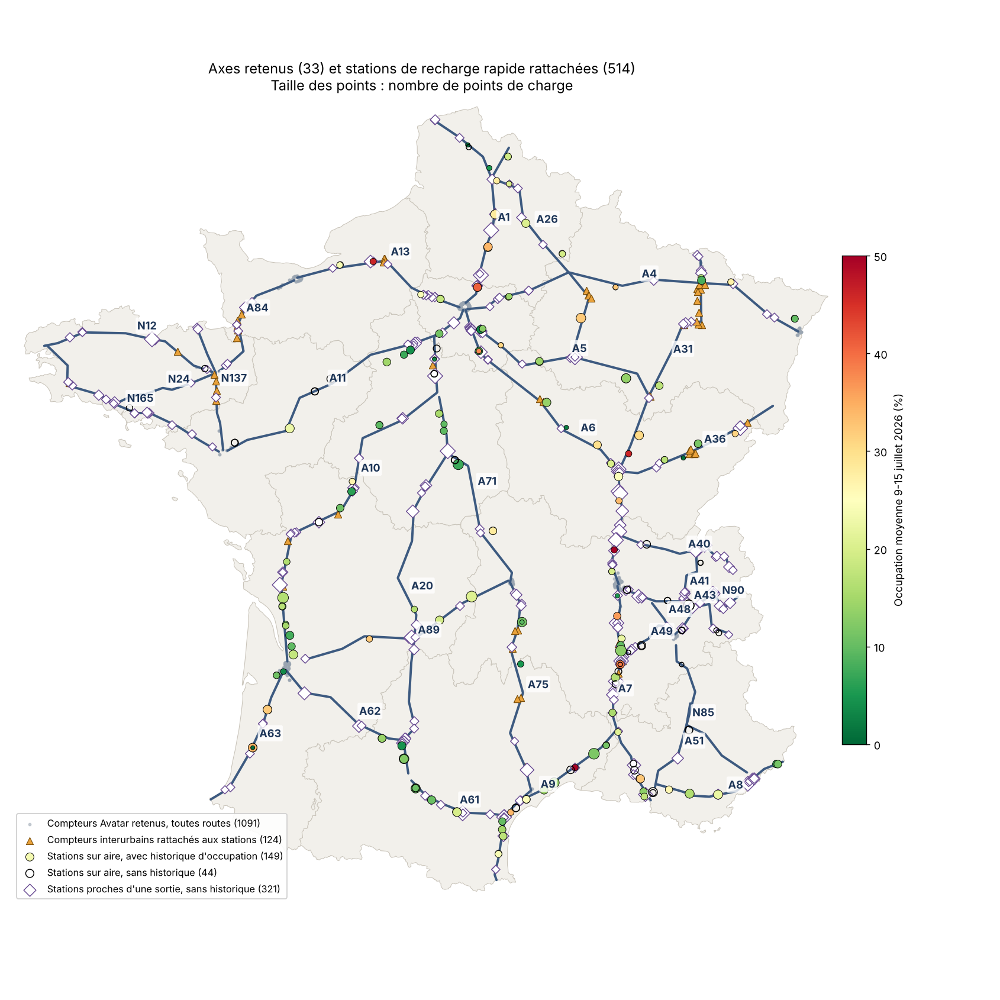
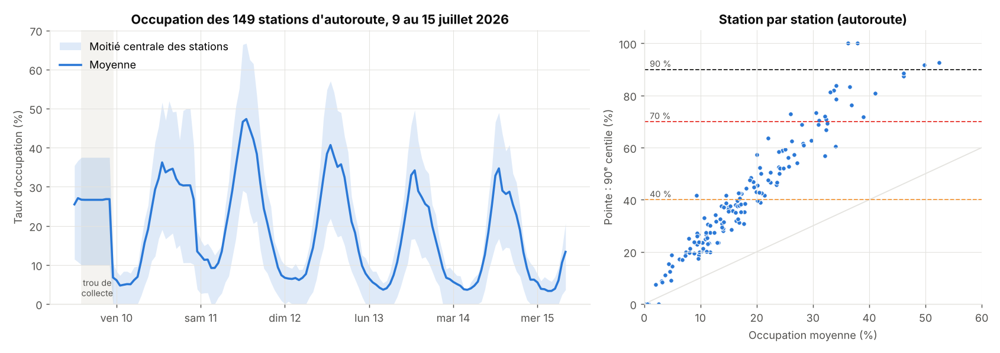
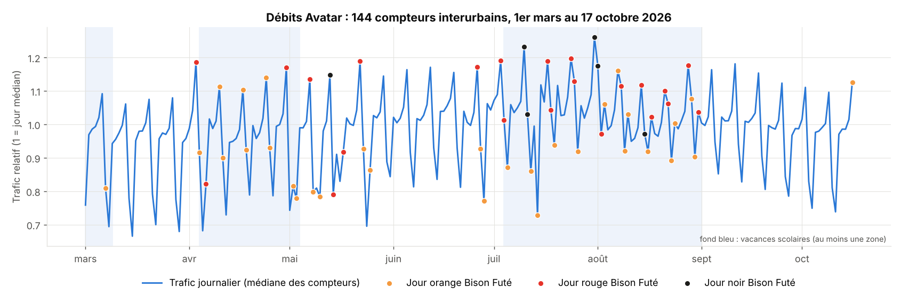
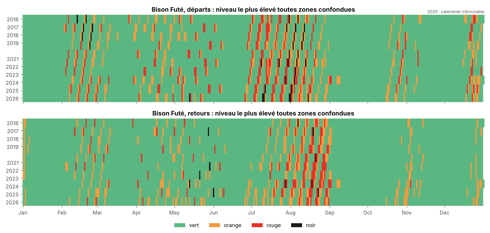
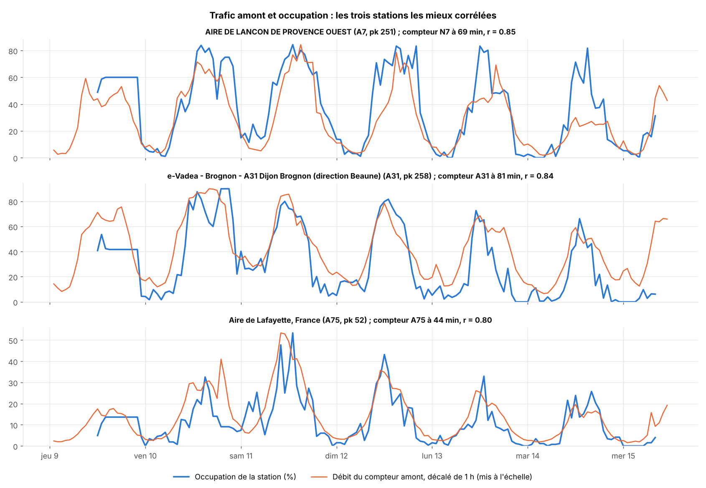

# Données réunies pour l'apprentissage du GNN

Cette note fait le point sur les données prêtes au 18 octobre 2026 pour entraîner le modèle lundi. Le détail
des méthodes est dans `note_technique.md`, et ce qui reste à faire dans `todo_lundi.md`.

## En un coup d'œil

| Donnée | Fichier | Couverture | Taille | Rôle dans le GNN |
|---|---|---|---|---|
| Stations de recharge rapide | `donnees_reelles/stations.csv` | 33 axes (autoroutes, nationales bretonnes et alpines) | 514 stations, 5 808 PDC | **Nœuds station** : position (axe, pk, sens), nombre de PDC, puissance, opérateur |
| Occupation des bornes (Qualicharge, échantillon) | `donnees_reelles/occupation_bornes.csv` | du 9 au 15 juillet 2026, au pas horaire | 20 751 lignes, 150 stations, 99,3 % de statut connu | **Cible** : taux d'occupation par station et par heure |
| Comptages routiers Avatar | `donnees_reelles/debits/` | du 1er mars au 17 octobre 2026, au pas horaire | 1 301 compteurs, 7,08 M lignes | **Nœuds trafic** : débit horaire |
| Rattachement compteurs → stations | `donnees_reelles/rattachement_interurbains/` | compteurs interurbains seulement | 124 compteurs, 273 nœuds, 278 arêtes, 682 liens | **Arêtes du graphe** : amont et aval sur chaque axe |
| Calendrier | `donnees_reelles/calendrier/calendrier.csv` | de 2016 à 2026, une ligne par jour | 4 018 jours, 32 variables | **Variables exogènes** communes à tous les nœuds |

## Comment ces données s'assemblent

Le graphe suit chaque axe dans chaque sens. Les nœuds sont les stations et les points de comptage, et
chaque arête relie un nœud à son voisin en aval, avec la distance en km. À chaque heure, le modèle reçoit :

- le **trafic** observé (ou prévu à l'étape 1) aux compteurs, qui se propage le long des arêtes ;
- les **caractéristiques fixes** des stations : nombre de PDC, puissance, opérateur, station sur aire ou près
  d'une sortie ;
- le **calendrier** : heure, jour de la semaine, vacances par zone avec le rang dans la période, fériés et
  ponts, et les couleurs Bison Futé par sens et par zone.

Il en sort le taux d'occupation de chaque station. Le script d'apprentissage accepte déjà les
tronçons HERE de 10 km comme nœuds de trafic (`entrainer.py --trafic here | here+avatar | avatar`) :
il ne manque que les données. Sur un HERE simulé, HERE seul fait mieux qu'Avatar et HERE + Avatar
n'apporte rien de plus ; ce sera à vérifier sur les vraies données. Avatar servira au moins à caler
l'indice de volume HERE en véhicules par heure.

## 1. Les stations et les axes

La sélection retient 514 stations, de trois façons :

- 131 ont le numéro de l'axe dans leur nom ;
- 62 sont sur une aire, à moins de 5 km du tracé ;
- 321 sont près d'une sortie, comme la plupart des Tesla. Ce sont des stations d'au moins 150 kW et 6 PDC, à
  moins de 2 km du tracé et hors des grandes agglomérations.

Le sens est connu pour 113 stations. Les 295 stations de sortie servent les deux sens (« hors aire »).
Les tracés sont encore approchés par des villes étapes, avec quelques km de précision. Les tracés
OpenStreetMap n'ont pas pu être téléchargés depuis le cloud.

## 2. L'occupation, qui est la cible

Seule une semaine de juillet est disponible pour l'instant, sur 150 stations. Elle montre déjà le cycle
journalier et l'écart entre stations : certaines dépassent 70 % d'occupation au P90, la plupart restent
sous 40 %. L'export complet de lundi doit couvrir mars à octobre et les 514 stations.

## 3. Le trafic Avatar

Les compteurs Avatar donnent un débit **horaire** du 1er mars au 17 octobre. Sur les 1 301 compteurs, 124 sont
interurbains et utiles ici : les autres comptent surtout du trafic local. On voit bien les week-ends, les
vacances d'été et les jours classés par Bison Futé.

Il n'y a aucun compteur sur la N24, l'A51, l'A40 et la N85.

## 4. Le calendrier et Bison Futé

Les couleurs Bison Futé ont été extraites des calendriers PDF officiels de 2016 à 2026. Il y a un niveau
national et un niveau par zone (1 Île-de-France à 6 arc méditerranéen), au départ et au retour. 2020
manque, et reste vide plutôt qu'en vert. Les vacances scolaires et les fériés viennent de l'open data.

Cet historique long sert surtout à l'étape 1 (prévoir le trafic) et aux prévisions au-delà de 7 jours.

## 5. Le lien entre trafic et occupation

Sur la semaine de juillet, le trafic du compteur le plus proche suit bien l'occupation pour certaines
stations : Lançon sur l'A7 (r = 0,85), Brognon sur l'A31 (0,84), Lafayette sur l'A75 (0,80). Sur les
71 stations reliées à un compteur interurbain, la corrélation médiane est de 0,58.

Une fois le cycle journalier retiré, elle tombe à 0,18. Le trafic explique donc surtout le rythme de la
journée, que le calendrier donne déjà. C'est le point à revérifier lundi sur l'historique complet.

## Limites à garder en tête

- **Une seule semaine d'occupation** tant que l'export Qualicharge n'est pas arrivé. On ne peut rien entraîner
  de sérieux avant.
- **344 stations sans historique** (321 de sortie, 23 sur aire) : elles ne seront dans l'apprentissage
  qu'avec l'export complet.
- **Un seul été** dans les données : la validation se fera par blocs de semaines, pas sur un seul découpage.
- **Avatar apporte peu hors cycle** (r = 0,18) et ne couvre pas quatre axes. HERE devrait devenir la source
  de trafic principale.
- **Temps d'apprentissage** : à l'échelle réelle (514 stations, environ 1 400 tronçons HERE), une époque
  du GNN prend 4,6 min sur un CPU 4 cœurs, soit environ une heure ; quelques minutes sur GPU.
- **Les stations de sortie** restent à relire sur la carte, pour écarter celles qui servent surtout le trafic
  local.

## Ce que lundi ajoute

- **Qualicharge** : l'occupation de mars à octobre pour les 514 stations, c'est-à-dire la vraie cible.
- **HERE** : les vitesses et la congestion par tronçon de 10 km sur les 33 axes, avec l'historique et Traffic
  Patterns pour l'étape 1. Il restera un petit script pour mettre l'extraction au format de
  `here_flux.py` (`donnees_reelles/here/here_troncons.csv`).
