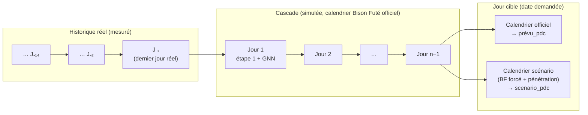
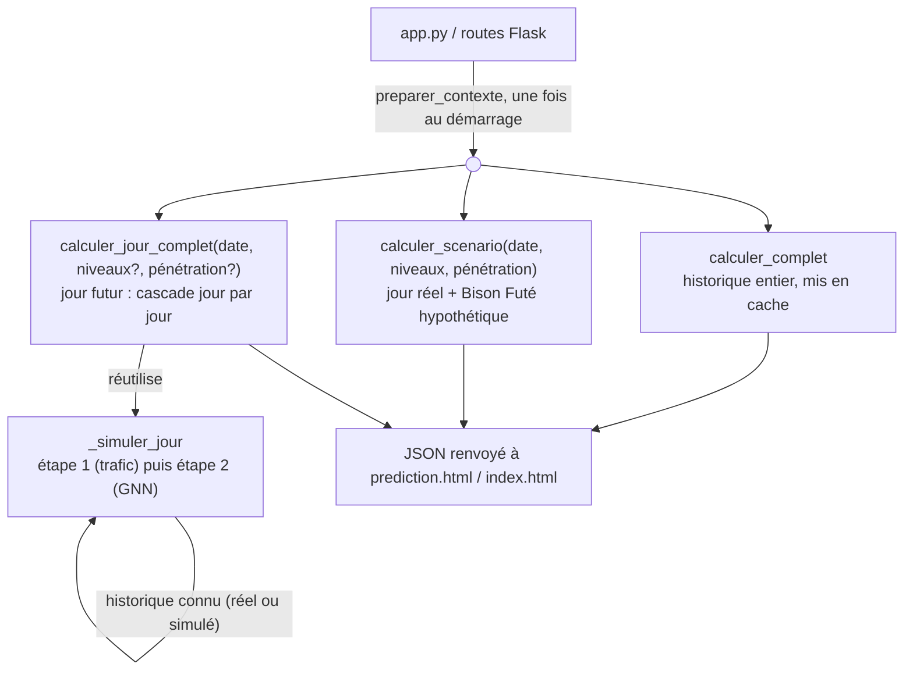

# Webapp — Bison Futé des bornes

Restitution Flask de `entrainer.py` : une carte de France des stations de recharge rapide
d'autoroute, et un volet « prédiction » qui rejoue le modèle (GNN, `gnn.py`) avec des hypothèses
Bison Futé différentes de ce qui s'est réellement passé. Ce document couvre la webapp elle-même
(pages, routes, données chargées) et surtout **le volet calcul** (`calcul.py`), qui est la partie
la plus dense : comment on passe des modèles entraînés (`resultats_reels/`) aux courbes affichées,
y compris pour un jour qui n'a tout simplement pas encore eu lieu.

Pour la théorie du modèle (graphe, GNN, étape 1/étape 2, scénarios de pénétration VE), voir
`../note_technique.md`, sections 3 à 7 — ce document n'y revient que pour mémoire, et détaille
plutôt comment `calcul.py` **réutilise** ces modèles en inférence.

```
webapp/
  app.py                  routes Flask, chargement des fichiers « plats » (stations, axes, zones, calendrier)
  calcul.py                tout le calcul : contexte GNN, occupation complète, scénarios, jour futur
  templates/index.html     carte principale (axes, zones Bison Futé, calendrier, courbe par station)
  templates/prediction.html volet prédiction (deux modes, voir §2)
  regions_france.geojson   contours des régions administratives, taguées par zone Bison Futé approchée
```

## 1. Lancer

```bash
.venv/bin/python webapp/app.py        # macOS/Linux
.venv\Scripts\python.exe webapp\app.py  # Windows
```

Puis ouvrir `http://127.0.0.1:5000` (carte) et `http://127.0.0.1:5000/prediction` (volet
prédiction). Le démarrage recharge les modèles de `resultats_reels/` et prépare le contexte GNN
(`preparer_contexte`, §3.1) : à prévoir **quelques secondes**, et le premier calcul de l'occupation
complète (`calculer_complet`, §3.2) la première fois que les modèles ont changé (ensuite mis en
cache).

Sur macOS, le port 5000 est parfois pris par le récepteur AirPlay (Réglages Système → Général →
AirPlay et Handoff, à désactiver) — ou par une instance déjà lancée (`lsof -nP -iTCP:5000`).

## 2. Les deux pages

### `index.html` — carte principale

Carte MapLibre (fond `openfreemap`) avec quatre couches de données, chacune sa route :

| Route | Contenu |
|---|---|
| `GET /api/stations` | GeoJSON des stations (position, axe, pk, nb PDC) |
| `GET /api/axes` | GeoJSON des axes autoroutiers (tracé approché) |
| `GET /api/zones` | GeoJSON des régions administratives, taguées par zone Bison Futé |
| `GET /api/calendrier` | une ligne par jour : vacances, fériés, ponts, couleurs Bison Futé |
| `GET /api/occupation/<station_id>?date=` | courbe horaire mesurée **et** calculée par le GNN, pour une station et une date |
| `GET /api/occupation_jour?date=` | occupation moyenne de chaque station ce jour-là, pour colorer la carte |

La zone Bison Futé de chaque région est une **approximation** (pas de table officielle
département → zone) : voir `REGION_VERS_ZONE_BF` dans `app.py`, choisi avec l'utilisateur
(Occitanie entière → zone 6, Centre-Val de Loire → zone 2).

### `prediction.html` — volet prédiction

Deux modes, voir §3.3 et §3.4 pour le calcul derrière chacun :

- **Jour observé** : un jour déjà survenu, avec un scénario Bison Futé hypothétique (le trafic et
  l'occupation passée restent les vraies valeurs mesurées ce jour-là — seule la couleur Bison Futé
  change).
- **Jour futur (prédiction complète)** : un jour au-delà des données réelles (ex. un jour férié à
  venir) — trafic et occupation n'existent pas encore, donc le modèle les prévoit aussi, en cascade
  depuis la fin des données réelles.

Dans les deux cas, la pénétration des véhicules électriques (VE) peut aussi être changée (théorie
des files d'attente, §3.3).

## 3. Le volet calcul (`calcul.py`)

### 3.1 Préparation du contexte : `preparer_contexte()`

Tout ce qui est coûteux et indépendant de la station/date demandée est fait **une seule fois**, au
démarrage du serveur, et gardé en mémoire (`CONTEXTE` dans `app.py`) :

1. **Chargement** des données réelles (`donnees.charger`), du graphe routier (`graphe.py`) et des
   matrices d'adjacence $\mathbf A^{\uparrow}, \mathbf A^{\downarrow}$ (note technique, §3.2).
2. **Normalisation du trafic** (variables « volume », ex. débit) par la moyenne apprise sur la
   période d'entraînement $\bar q_c$ :
   $$
   \tilde q_c(t) = \frac{q_c(t)}{\bar q_c}
   $$
3. **Rechargement de l'étape 1** (`modeles_hgb.joblib`) et **comblement des trous** de mesure par
   sa prévision — c'est le tableau `trafic_obs_n` que la cascade (§3.4) réutilise :
   $$
   \hat q_c(t) =
   \begin{cases}
   \tilde q_c(t) & \text{si mesuré ce pas-là} \\
   \hat{\tilde q}_c(t) & \text{sinon (prévu par l'étape 1, note technique §4.2)}
   \end{cases}
   $$
4. **Construction du tenseur d'entrée du GNN**, $\mathbf X \in \mathbb R^{T \times N \times F}$ — un
   nœud par station **et** par compteur ($N = S + C$), $F = 11$ colonnes dans la configuration
   actuelle (1 variable de trafic) :

   | Bloc | Colonnes | Contenu |
   |---|---|---|
   | `f_tr` | $V$ (= 1) | trafic $\hat q_c(t)$ au nœud (nul pour les nœuds-stations) |
   | `f_type` | 3 | indicateur station / compteur Avatar / tronçon HERE |
   | `f_occ` | $\lvert\mathcal L\rvert + 1$ (= 5) | occupation $y(s,t-k)$ pour $k \in \mathcal L = \{24,48,168,336\}$ pas, et $\bar y^{24}(s,t)$ |
   | `m_occ` | 1 | masque : $y(s, t-H)$ est-il observé ? |
   | capacité | 1 | $n^{\text{PDC}}_s / 10$ |

5. **Rechargement du GNN** (`modele_gnn.pt`) déjà entraîné — aucun ré-apprentissage ici, uniquement
   de l'inférence (`predire_gnn`, `gnn.py`).
6. **`debut`** : le premier pas de temps où le GNN a assez d'historique pour tourner,
   $$
   t_{\text{début}} = \max\bigl(T_{\text{in}} - 1,\ \max \mathcal L\bigr)
   $$
   ($T_{\text{in}} = 6$ pas pour la fenêtre temporelle, $\max\mathcal L = 336$ pas = 14 jours pour le
   plus long retard d'occupation). Avant `debut`, aucun calcul n'est possible.

### 3.2 Occupation sur tout l'historique : `calculer_complet()`

Appelle le GNN sur tous les pas $t \ge t_{\text{début}}$, avec les vraies valeurs observées
(trafic et occupation passée). Le résultat est mis en cache dans
`resultats_reels/calcule_complet.csv.xz`, recalculé seulement si ce fichier est plus ancien que les
modèles sauvegardés (`_cache_a_jour`). C'est la courbe « calculée » qu'`index.html` superpose à la
mesure réelle pour chaque station.

### 3.3 Un jour déjà survenu, scénario hypothétique : `calculer_scenario()`

Pour une date $J$ de l'historique et des niveaux Bison Futé $\nu_z \in \{0,1,2,3\}$ (vert, orange,
rouge, noir) par zone $z \in \{1,\dots,6\}$, **seule l'entrée calendaire change** :

$$
\text{bf\_depart}_z(J) \leftarrow \nu_z, \quad
\text{bf\_retour}_z(J) \leftarrow \nu_z, \quad
\text{bf\_depart}(J) = \text{bf\_retour}(J) \leftarrow \max_z \nu_z
$$

Le trafic $\hat q_c(t)$ et l'occupation passée $y(s, t-k)$ restent les **vraies valeurs mesurées**
ce jour-là : le GNN voit le trafic directement au pas $t$ prédit (pas de retard), comme s'il
disposait de compteurs en temps réel — c'est ce qui rend le scénario possible pour un jour déjà
survenu (on sait ce qui s'est réellement passé) et **impossible** pour un jour futur sans adaptation
(§3.4).

**Pénétration VE** (optionnelle) : la charge offerte $A(s,t)$ est retrouvée par inversion d'Erlang B
à partir de l'occupation prédite $\hat y(s,t)$, mise à l'échelle par le rapport de pénétration, puis
reconvertie en occupation (note technique §7) :

$$
A' = A \cdot \frac{p'}{p_{\text{ref}}}, \qquad y' = \frac{A'\,(1 - B(A', c))}{c}
$$

avec $p_{\text{ref}} \approx 3\,\%$ (quasi constant sur l'historique). C'est une transformation
appliquée **après** le GNN, jamais réinjectée dans le modèle.

### 3.4 Un jour au-delà des données réelles : `calculer_jour_complet()`

C'est la partie la plus récente du module, et celle qui mérite le plus d'explications.

**Le problème.** `calculer_scenario` suppose que le trafic et l'occupation passée du jour prédit
sont connus (de vraies mesures). Pour un jour futur (ex. le 1ᵉʳ novembre à venir), rien de tout ça
n'existe : ni compteurs, ni occupation mesurée. Il faut donc **aussi prévoir** le trafic (étape 1)
et l'occupation (étape 2), pas seulement rejouer le calendrier.

**L'observation qui rend ça possible sans tout réapprendre.** Les retards utilisés par les deux
étapes sont tous $\geq H$ (l'horizon, 24 pas = 24 h) :

$$
\mathcal L = \{24,\ 48,\ 168,\ 336\} \text{ pas} = \{1,\ 2,\ 7,\ 14\} \text{ jours}
$$

**Aucun retard ne tombe dans la journée en cours** : quelle que soit l'heure $h$ du jour $D$ qu'on
prédit, $t - k$ (pour $k \in \mathcal L$) tombe toujours au plus tard la **veille** de $D$. Donc, si
le jour $D-1$ est entièrement connu (mesuré, ou déjà simulé), le jour $D$ peut être calculé en entier
— ses 24 heures sont indépendantes **entre elles** (aucune ne dépend d'une autre heure du même
jour), même si elles dépendent du modèle lui-même (étape 1 puis étape 2) pour produire leurs propres
valeurs. Il suffit donc d'avancer **jour par jour**, pas heure par heure :



**Pour chaque jour $D$ de la cascade**, à partir de l'historique déjà connu (réel ou simulé) :

1. **Étape 1 — trafic**, pour chaque compteur $c$ et chaque heure $t$ du jour :
   $$
   \hat{\tilde q}_c(t) = f^{(1)}\Bigl(\text{calendrier}(t),\ \text{stat}_1(c),\ \{\tilde q_c(t-k)\}_{k \in \mathcal L},\ \bar{\tilde q}_c^{24}(t)\Bigr)
   $$
   avec le même modèle de gradient boosting déjà entraîné (note technique §4.2) — aucun paramètre
   n'est réajusté, seules les entrées changent.
2. **Construction du tenseur du jour** (mêmes blocs qu'en §3.1, `_tenseur_jour`), à partir de la
   prévision de trafic qui vient d'être calculée et des lags d'occupation déjà connus.
3. **Étape 2 — occupation**, par le GNN (`predire_gnn`), sur une fenêtre $T_{\text{in}}$ qui peut
   chevaucher la fin du jour précédent (déjà calculé) :
   $$
   \hat y(s,t) = \mathrm{GNN}\Bigl(\{\mathbf X(t')\}_{t'=t-T_{\text{in}}+1}^{\,t}, \ \text{calendrier}_{\text{GNN}}(t)\Bigr)
   $$
4. Le trafic et l'occupation ainsi obtenus deviennent l'historique **connu** pour les jours
   suivants de la cascade — exactement comme s'ils avaient été mesurés.

**Le calendrier des jours intermédiaires** est le Bison Futé **officiel**, déjà publié dans
`calendrier.csv` (qui couvre toute l'année en cours, bien au-delà des données réelles). Seul le
**dernier jour** (la date demandée) peut recevoir un scénario hypothétique : dans ce cas il est
simplement **rejoué une seconde fois**, avec les colonnes Bison Futé modifiées, à partir du **même**
historique (les jours précédents ne changent pas — un seul passage de cascade sert aux deux
courbes). C'est pour ça que la réponse de l'API distingue `prevu_pdc` (calendrier officiel) et
`scenario_pdc` (hypothèse, ou `null` si aucun scénario n'a été demandé).

La **pénétration VE**, si elle est différente de la référence, n'est appliquée (Erlang B, §3.3)
qu'au jour cible affiché — jamais aux jours intermédiaires de la cascade, pour que les retards
d'occupation utilisés par le jour suivant restent une estimation « normale », et non biaisée par
l'hypothèse du jour cible.

**Bornes.** `bornes_jour_complet()` donne la plage prédictible : du lendemain du dernier jour réel
jusqu'à la dernière date présente dans `calendrier.csv` (le Bison Futé officiel n'étant publié
qu'à l'avance jusqu'à une certaine date). Une date déjà couverte par l'historique réel, ou hors de
cette plage, renvoie `None` (→ 400 côté API).

**Coût.** Pas de cache ici (le résultat dépend de la date et du scénario demandés) : chaque appel
recalcule toute la cascade. Mesuré sur les 514 stations réelles : environ 0,15 s pour 1 jour de
cascade, 3,7 s pour 33 jours, 13 s pour la cascade maximale (~93 jours, jusqu'à fin décembre).

### 3.5 Vue d'ensemble : qui calcule quoi



## 4. Récapitulatif des routes

| Route | Méthode | Rôle |
|---|---|---|
| `/` | GET | carte principale |
| `/prediction` | GET | volet prédiction |
| `/api/stations`, `/api/axes`, `/api/zones` | GET | couches géographiques |
| `/api/config` | GET | référence de pénétration VE, bornes de la plage « jour complet » |
| `/api/calendrier` | GET | calendrier complet (vacances, fériés, Bison Futé officiel) |
| `/api/occupation/<station_id>?date=` | GET | mesuré + calculé, pour une station et une date |
| `/api/occupation_jour?date=` | GET | moyenne par station ce jour-là (coloration carte) |
| `/api/scenario` | POST | §3.3 — jour réel, Bison Futé hypothétique |
| `/api/jour_complet` | POST | §3.4 — jour futur, cascade + scénario optionnel |

## 5. Limites connues

- La cascade (§3.4) suppose que le modèle appris sur une saison (ici juillet-septembre) reste
  valable pour les mois suivants (automne, hiver) : aucune donnée réelle de cette période n'a encore
  été vue par le GNN ni par l'étape 1.
- Les zones Bison Futé par région sont approchées (§2), pas officielles.
- `sens` (direction d'une station) est souvent inconnu (`0`, voir la discussion dans l'historique du
  projet) : le modèle ne distingue alors pas « dessert vraiment les deux sens » de « sens non
  détecté ».
- Le calendrier Bison Futé officiel n'est publié qu'à l'avance jusqu'à une certaine échéance :
  passé cette date, `calculer_jour_complet` refuse (voir `bornes_jour_complet`).
